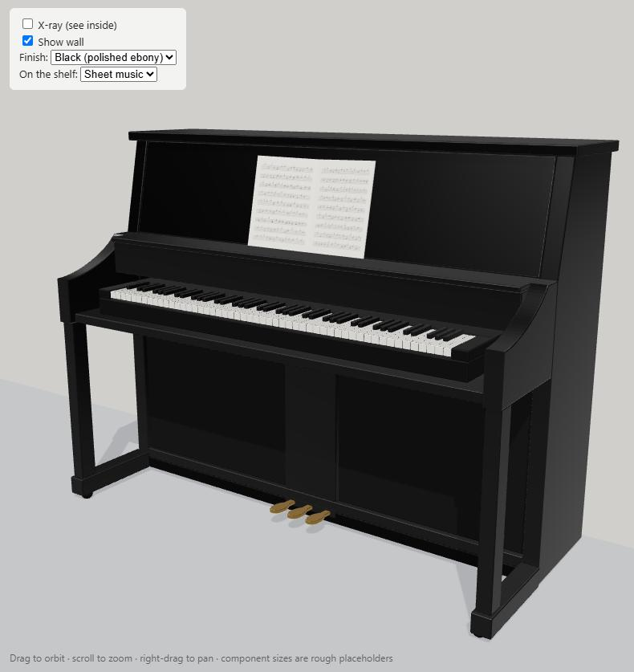
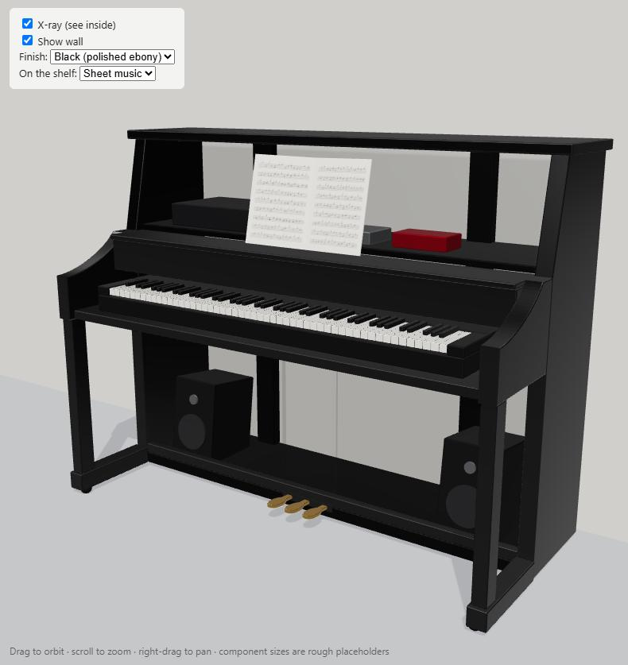

# Hardware

The physical side of piano-lab at home: the cabinet it lives in, and later notes on the PC, audio interface and speakers.

## The cabinet concept
A piece of living-room furniture that looks like an upright piano. Inside it are a PC running piano-lab, an amplifier, an audio interface and speakers, and a shelf holds a MIDI keyboard. Nothing in it should look like a studio.

| Closed | X-ray (front panels see-through) |
|---|---|
|  |  |

### Decisions so far
- **Shape:** an upright piano, always against a wall, with an open back. The open back lets the speakers and the electronics breathe, and gives access from behind.
- **Upper panel:** slanted back 12 degrees, one seamless panel that lifts off (hidden clips or magnets), as on a real upright.
- **Height:** 1.20 m. The upper section is sized so open sheet music on the shelf clears the lid by about 3 cm.
- **No built-in screen.** A phone or tablet running the web UI rests on the shelf on top of the fallboard, where sheet music would go. It reaches piano-lab over the local network, not `localhost`, so this cabinet needs [network mode](../plan/milestone-0.md#09-network-mode-and-pairing) (plan step 0.9).
- **Electronics:** behind the slanted upper panel, on a shelf just above the fallboard: a Mini-ITX PC (about 7.6 × 25 × 36 cm, lying flat), a Fosi amplifier and a Focusrite Scarlett audio interface. The PC is quiet enough to sit near the player's head.
- **Speakers:** Polk ES15s in the lower corners, facing forward behind acoustically transparent fabric. The knee board is fabric except a narrow wooden panel (about 20 cm) above the pedals, like a grand piano's pedal lyre. Rear-only speakers were set aside: aimed into the wall, the treble would likely be dull and uneven.
- **Keyboard:** a sturdy shelf takes a range of 88-key keyboards. Their own buttons are ignored except power, which is reached under the overhang. The fallboard hides the keyboard's back panel and sits 1.5 cm above the black keys, so the keyboard slides in and out.
- **Style:** curved cheek blocks inspired by a Boston upright, flush with the top of the shelf; straight legs; brass pedals; a black polished finish.

### Not decided yet
- **Component sizes other than the PC are placeholders.** The speakers, amplifier, audio interface and keyboard are rough guesses, not checked against spec sheets. Measure them before designing any wood around them.
- How the speakers are damped and decoupled inside the cabinet.
- One-button power (turning everything on and off in order) is left for a later version.

## The 3D model
[cabinet-model.html](cabinet-model.html) is an interactive three.js model of the concept. Drag to orbit, scroll to zoom, right-drag to pan. Its panel switches:
- **X-ray:** makes the fabric and front panels see-through, to show the gear inside.
- **Show wall:** shows or hides the wall behind the piano.
- **Finish:** walnut or polished black.
- **On the shelf:** nothing, a phone, a tablet or sheet music. The phone and tablet show a mock-up of a piano plugin screen.
- **Path-traced still:** switches from the real-time view to a path tracer, which refines the same view sample by sample, with soft shadows, true reflections and light bouncing between surfaces. *Save PNG* downloads the current image. Orbiting or changing anything starts it over.

### Parametric: every dimension is a slider
The model is built entirely from named parameters, so it can be tweaked without touching the code. The way of working: Claude builds the geometry from reference photos or descriptions, and the owner fine-tunes it with the sliders.
- **Dimensions panel** (top right): every design dimension in centimetres or degrees, in folders by part (cabinet, lid, upper section, cheek blocks, pedals, gear, ...). Moving a slider rebuilds the model at once. Changed values are highlighted, and double-clicking a value's name puts it back to its default.
- **What has no slider:** derived dimensions, which follow from the others (the upper section's height, for example, comes from the overall height and the music shelf height), and cosmetic numbers such as edge rounding and bevels.
- **Report** (left): the derived dimensions, read-only, and **checks** that turn the design rules into margins, such as "sheet music clears the lid by at least 3 cm". A failing check turns red.
- **Values:** *Copy changed values* puts the changed values on the clipboard as JSON, to paste into a chat or an issue. *Paste values* loads a set back (anything not in it returns to its default), and *Reset to defaults* starts over. Tweaks are also kept in the browser across reloads, unless a new version of the file changes that value's default.

The defaults in the file are the current design. To adopt a set of tweaks, paste the changed values to Claude, who commits them as the new defaults.

### Materials and light
The wood, floor, speaker fabric and brass use photographed textures (colour, surface bumps and glossiness), mapped at their real size, and the room light and reflections come from an HDRI photo of a living room. The black finish is plain polished lacquer, with no visible grain.

The first switch to the path tracer compiles a large shader, which takes from a few seconds to a couple of minutes depending on the graphics card (about 1½ minutes on integrated Intel graphics). After that, a few hundred samples give a clean image.

### Textures
All in [textures/](textures/), all **CC0** (public domain, no attribution needed; listed here anyway). The ambientCG maps were re-encoded smaller.

| Files | Used for | Source |
|---|---|---|
| `wood_table_001_*_2k.jpg` | Walnut wood | [Wood Table 001](https://polyhaven.com/a/wood_table_001), Poly Haven |
| `laminate_floor_02_*_1k.jpg` | Floor | [Laminate Floor 02](https://polyhaven.com/a/laminate_floor_02), Poly Haven |
| `fabric030_*_1k.jpg` | Speaker fabric | [Fabric 030](https://ambientcg.com/a/Fabric030), ambientCG |
| `metal009_*_1k.jpg` | Brushed brass (bumps and glossiness; the colour is the material's) | [Metal 009](https://ambientcg.com/a/Metal009), ambientCG |
| `lebombo_2k.exr` | Room light and reflections | [Lebombo](https://polyhaven.com/a/lebombo), Poly Haven |

### Opening it
The page loads its textures from the `textures` folder, which browsers block for pages opened as local files. Serve the `docs/hardware` folder with any static file server, for example `python -m http.server --directory docs/hardware`, and open `http://localhost:8000/cabinet-model.html`.

It loads **three.js 0.187.0** and **three-gpu-pathtracer 0.0.28** (with **three-mesh-bvh 0.10.0**) from the jsDelivr CDN, pinned to those exact versions, so it needs an internet connection. It's a design sketch, not part of piano-lab: nothing builds or tests it.
